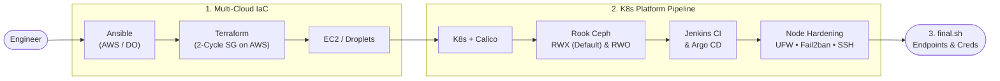

# NextGen V2 DevOps Platform: ArgoCD, GitOps & CephFS (Multi-Cloud)

🚀 **One-click end-to-end DevOps platform deployment across AWS and DigitalOcean.** The entire infrastructure, enterprise-grade storage (RWX & RWO), dynamic cloud firewalling, node security hardening, and platform lifecycle is fully orchestrated via Ansible (with Terraform executed internally) on your choice of **Amazon Web Services (AWS)** or **DigitalOcean**.

This next-generation iteration bootstraps a Kubernetes (K8s) cluster, applies automated OS-level security hardening, deploys a high-availability Rook Ceph storage layer supporting both shared filesystem (`ReadWriteMany`) and block (`ReadWriteOnce`) volumes, an Argo CD GitOps engine, and a Jenkins server from scratch using a modular Bash script pipeline—automatically provisioning application build jobs via the Jenkins API and preparing declarative storage volumes.

---

## 🏗️ Architecture & Workflow

* **Multi-Cloud Infrastructure (Terraform inside Ansible):** Ansible acts as the single entry point, triggering dedicated Terraform configurations under the hood to automatically provision cloud compute instances (AWS EC2 or DigitalOcean Droplets) and networking. Dynamic inventory is managed entirely in-memory.
* **Two-Cycle Dynamic Cloud Firewalling (AWS):** On AWS, Terraform runs in two orchestrated cycles (`bootstrap_aws.yml`)—first establishing isolated `kserver-sg` and `knode-sg` internal cluster rules, and then re-running after platform deployment to open only the exact dynamically assigned `NodePort`s for Jenkins, Argo CD, and Nginx.
* **Platform Bootstrap (Ansible & Bash):** A comprehensive multi-step configuration playbook coordinates localized system preparations, network policies (Calico CNI), and Kubernetes cluster initialization (`install_kubernetes_v3.sh` & `install_kubernetes_worker_v2.sh`) via native Bash scripting layers.
* **Automated OS & Node Security Hardening (`node-hardening.sh`):** Dynamically detects node roles (`control-plane` vs. `worker`) and hardens every instance out of the box:
  * **Role-Aware Firewall (UFW):** Configures strict ingress/egress rules tailored for Kubernetes API/etcd, Calico BGP/VXLAN/IP-in-IP (protocol 4), and Rook-Ceph OSD/Monitor/MDS traffic.
  * **SSH & Intrusion Prevention:** Enforces hardened `sshd` policies and deploys **Fail2ban** to block SSH brute-force attacks.
  * **Kernel & OS Patching:** Applies Kubernetes-compatible `sysctl` network security parameters and enables `unattended-upgrades` for automated security patching.
* **Cloud-Native Storage (Rook Ceph — RWX & RWO):** Automates kernel configuration (`rbd` module loading), installs the Rook operator, and provisions a resilient Ceph storage cluster offering dual access modes:
  * **Shared Filesystem (`ReadWriteMany` — Default):** Deploys a `CephFilesystem` (CephFS) and dedicated `StorageClass` (`conf_ceph_storage_rwx.sh`) enabling concurrent multi-pod read/write access inside the shared `argocd` namespace.
  * **Block Storage (`ReadWriteOnce` — Alternative):** Maps a `CephBlockPool` and RBD `StorageClass` (`conf_ceph_storage_rwo.sh`) for dedicated block volumes (mounted by a single pod at a time) isolated inside the `jenkins` namespace.
* **Continuous Integration (Jenkins):** Deploys Jenkins via Helm and leverages the Jenkins Remote Access API (`job_build_api.sh`) to programmatically inject the active Nginx build pipeline template (`nginx_rwx.xml` by default, or `nginx_rwo.xml` when toggled in Ansible) directly into the cluster.
* **GitOps Continuous Delivery (Argo CD):** Bootstraps Argo CD directly into the cluster to enforce declarative git-centric continuous delivery, implementing the GitOps model for seamless deployment and storage synchronization.
* **Summary & Output (Final Layer):** The automation process concludes by executing the final script layer (`final.sh`). All generated endpoints, credentials, and health statuses are cleanly displayed in the console output.

---



---

## 🔄 CI/CD & GitOps Core Philosophy

This platform implements a modern **Separation of Concerns** pattern between CI (Continuous Integration) and CD (Continuous Delivery):

* **Jenkins (CI / Automation Trigger):** Acts as the initial automation engine. Out of the box, it interacts via API (`nginx_rwx.xml`) to deploy a functional Nginx demo application into the shared `argocd` namespace, verifying that cluster routing, compute, and Rook Ceph RWX storage are fully operational.
* **Argo CD (GitOps Engine):** Fully deployed, pre-configured, and co-located with the Nginx demo workload in the `argocd` namespace. Because both share a `ReadWriteMany` (CephFS) volume, Argo CD can immediately synchronize Git repositories directly with the live Nginx deployment.

---

## 📂 Repository Structure

```text
nextgen-v2-devops-platform-argocd-gitops-cephfs/
├── ansible/
│   ├── bootstrap_aws.yml               # Master playbook for AWS deployment (Runs 2-cycle Terraform & platform setup)
│   └── bootstrap_do.yml                # Master playbook for DigitalOcean deployment (Runs Terraform & platform setup)
├── scripts/                            # --- MODULAR PLATFORM PIPELINE ---
│   ├── conf_ceph_storage_rwo.sh        # Configures Ceph RBD block storage pool & RWO StorageClass
│   ├── conf_ceph_storage_rwx.sh        # Configures CephFS shared filesystem & RWX StorageClass (Default)
│   ├── final.sh                        # Summarizes cluster state: outputs node IPs, credentials, Jenkins & Argo CD URLs
│   ├── install_apt_helm.sh             # Installs system dependencies and Helm package manager
│   ├── install_argocd.sh               # Installs and bootstraps the Argo CD platform
│   ├── install_calico.sh               # Configures Calico CNI networking plugin
│   ├── install_helm_jenkins.sh         # Automates the Jenkins platform deployment via Helm
│   ├── install_k8s_rook.sh             # Deploys the Rook Ceph operator into the cluster
│   ├── install_kubernetes_v3.sh        # Provisions Kubernetes Control Plane nodes
│   ├── install_kubernetes_worker_v2.sh # Joins worker nodes to the active K8s cluster
│   ├── job_build_api.sh                # Executes deployment triggers via Jenkins Remote Access API
│   ├── modprobe_rbd.sh                 # Loads the Ceph RADOS Block Device (RBD) kernel module
│   ├── nginx_rwo.xml                   # Jenkins Job XML template for Nginx with RWO block storage (jenkins namespace)
│   ├── nginx_rwx.xml                   # Jenkins Job XML template for Nginx with RWX shared storage (argocd namespace)
│   └── node-hardening.sh               # Role-aware OS security hardening (UFW, Fail2ban, SSH, sysctl)
├── storage/                            # --- CLOUD-NATIVE STORAGE MANIFESTS ---
│   ├── cephblockpool.yaml              # Defines the Ceph logical block storage pool (RWO)
│   ├── cephfilesystem.yaml             # Defines the CephFS shared filesystem (RWX)
│   ├── cephstorageclass_fs_rwx.yml     # Configures the K8s StorageClass mapping to Rook CephFS (RWX)
│   ├── cephstorageclass.yaml           # Configures the K8s StorageClass mapping to Rook Ceph RBD (RWO)
│   ├── pvc_nginx_rwx.yaml              # PersistentVolumeClaim for Nginx shared storage in argocd namespace (RWX)
│   └── pvc_nginx.yaml                  # PersistentVolumeClaim for Nginx block storage in jenkins namespace (RWO)
├── terraform_aws/                      # --- AWS INFRASTRUCTURE AS CODE ---
│   ├── main.tf                         # AWS EC2, VPC & 2-cycle dynamic Security Groups (executed by Ansible)
│   └── terraform.tfvars.example        # Variable template for AWS credentials, region, and SSH keys
└── terraform_do/                       # --- DIGITALOCEAN INFRASTRUCTURE AS CODE ---
    ├── main.tf                         # DigitalOcean Droplet resource templates (executed by Ansible)
    └── vars.auto.tfvars.example        # Variable template for DO API access tokens and SSH keys
```

---

## 🛡️ Cloud Networking & Two-Cycle AWS Security Groups

Unlike DigitalOcean—where traffic filtering is handled directly on the instances via the host-level UFW firewall (`node-hardening.sh`)—**Amazon Web Services (AWS)** enforces stateful perimeter security via **VPC Security Groups** (`kserver-sg` & `knode-sg`).

Instead of blindly exposing the entire Kubernetes `NodePort` range (`30000–32767`), the AWS deployment uses a **two-cycle Terraform execution loop** orchestrated by Ansible (`bootstrap_aws.yml`):

```text
[Cycle 1: Terraform] ──▶ Provision EC2 + Internal SG Rules (SSH + All Cluster/Calico Traffic)
         │
         ▼
[K8s Platform Setup] ──▶ Deploy Jenkins, Argo CD & Nginx ──▶ Capture Dynamic NodePorts
         │
         ▼
[Cycle 2: Terraform] ──▶ Inject jenkins_port, argocd_port & nginx_demo_port into kserver-sg
```

### How the Two-Cycle Security Group Design Works

* **Role-Separated Security Groups:** `kserver-sg` (Control Plane) and `knode-sg` (Worker Nodes) allow unrestricted internal east-west communication (`protocol = "-1"`, including **Calico IP-in-IP / protocol 4** and **Rook Ceph** OSD/Monitor traffic) strictly between cluster members (`self` and cross-SG rules).
* **Cycle 1 — Base Infrastructure Provisioning:** On the initial `terraform apply`, the dynamic port variables (`jenkins_port`, `argocd_port`, `nginx_demo_port`) default to `null`. Terraform creates the EC2 instances and opens only port `22` (SSH) plus internal cluster networking.
* **Cycle 2 — Dynamic NodePort Exposure:** After Kubernetes, Argo CD, Jenkins, and the Nginx demo workload are deployed, Ansible queries the cluster for the dynamically assigned `NodePort` values and re-runs Terraform (`count = var.<service>_port != null ? 1 : 0`) to open **only those exact three TCP ports** on `kserver-sg`.

---

## 💾 Storage Architecture & Deployment Modes (RWX vs. RWO)

The platform provisions **Rook Ceph** with dual storage capabilities, allowing workloads to leverage either a shared distributed filesystem or dedicated block storage depending on the Ansible playbook configuration:

| Feature / Attribute | RWX Mode (Default Active) | RWO Mode (Alternative Profile) |
| :--- | :--- | :--- |
| **Access Mode** | `ReadWriteMany` (RWX) | `ReadWriteOnce` (RWO) |
| **Ceph Backend** | **CephFS** (`CephFilesystem`) | **Ceph RBD** (`CephBlockPool`) |
| **Target Namespace** | Shared **`argocd`** namespace | Isolated **`jenkins`** namespace |
| **Jenkins Job Template** | `nginx_rwx.xml` | `nginx_rwo.xml` |
| **Storage Script** | `conf_ceph_storage_rwx.sh` | `conf_ceph_storage_rwo.sh` |
| **Git-to-PVC Sync** | Supported (multi-pod mount) | Not supported (exclusive RWO lock) |

### How Shared Namespace & GitOps Sync Work (RWX Default)
* **Why `argocd` Namespace + RWX?** In the default configuration, the Nginx demo application is deployed directly into the **`argocd` namespace** using a `ReadWriteMany` (`CephFS`) PersistentVolumeClaim (`pvc_nginx_rwx.yaml`).
* **Seamless Git-to-Storage Synchronization:** Placing Nginx and Argo CD within a shared namespace backed by RWX storage allows multiple pods (such as `git-sync` workers and Nginx web pods) to concurrently mount, read, and write to the same persistent volume—enabling direct Git repository content synchronization with the live Nginx instance.

### Switching to RWO Mode (Block Storage Profile)

If you prefer **Ceph RBD block storage (`ReadWriteOnce`)** with Nginx isolated in the **`jenkins` namespace**, update two `src` paths in your target Ansible playbook (`ansible/bootstrap_aws.yml` or `ansible/bootstrap_do.yml`) **before** running the deployment:

1. **Play 10 (Storage Configuration Task)** — change `conf_ceph_storage_rwx.sh` to `conf_ceph_storage_rwo.sh`:
   ```yaml
   - name: Copy ceph storage configure script
     ansible.builtin.copy:
       src: ../scripts/conf_ceph_storage_rwo.sh # Changed from _rwx.sh to _rwo.sh
       dest: /home/kubeuser/conf_ceph_storage.sh
       mode: '0777'
   ```

2. **Play 13 (Jenkins Demo Job Task)** — change `nginx_rwx.xml` to `nginx_rwo.xml`:
   ```yaml
   - name: Copy demo nginx pipeline xml file
     ansible.builtin.copy:
       src: ../scripts/nginx_rwo.xml # Changed from _rwx.xml to _rwo.xml
       dest: /home/kubeuser/nginx.xml
       mode: '0777'
   ```

Once updated, run `ansible-playbook` as usual—the cluster will provision a `CephBlockPool` (`RWO`) and deploy the Nginx demo job into the `jenkins` namespace.

> **Note:** In **RWO mode**, the optional **Git-to-PVC synchronization via Argo CD is not supported**. Because `ReadWriteOnce` block storage can only be mounted by a single node/workload at a time (and Nginx runs isolated in the `jenkins` namespace), a separate `git-sync` pod cannot concurrently mount and write to the same volume.

---

## 🚀 Getting Started

### 1. Prerequisites

Ensure you have the following tools, credentials, and configurations ready on your local control node before execution:

* **Ansible** (installed locally)
* **Terraform** (installed locally)
* **SSH Key Pair** (generated locally via `ssh-keygen`, e.g., `~/.ssh/id_ed25519.pub`)
* **Cloud Credentials** for your chosen provider:
  * **Option A (AWS):** IAM User Access Key & Secret Key with EC2/VPC permissions.
  * **Option B (DigitalOcean):** Personal Access Token (Read/Write API token) generated from the DigitalOcean console.

---

### 2. Configuration (Choose Your Cloud Provider)

#### Option A: Amazon Web Services (AWS)

Navigate to the `terraform_aws/` folder, copy the template variable file, and populate it with your AWS credentials:

```bash
cd terraform_aws
cp terraform.tfvars.example terraform.tfvars
```

Open `terraform.tfvars` and update the placeholders:

```hcl
aws_access_key = "YOUR_AWS_ACCESS_KEY_ID"
aws_secret_key = "YOUR_AWS_SECRET_ACCESS_KEY"
aws_region     = "eu-central-1"
public_key     = "~/.ssh/id_ed25519.pub"
```

#### Option B: DigitalOcean

Navigate to the `terraform_do/` folder, copy the template variable file, and populate it with your DigitalOcean credentials:

```bash
cd terraform_do
cp vars.auto.tfvars.example vars.auto.tfvars
```

Open `vars.auto.tfvars` and update the placeholders:

```hcl
digitalocean_token = "YOUR_DIGITALOCEAN_API_TOKEN"
public_key         = "~/.ssh/id_ed25519.pub"
```

---

### 3. One-Click Deployment

Return to the project root directory. The entire platform lifecycle—from cloud instance provisioning, two-cycle firewalling (AWS), security hardening, and RWX/RWO storage pooling to GitOps bootstrap and CI pipeline rendering—is managed using a single entry point for your chosen cloud.

* **Deploy on AWS:**

```bash
ansible-playbook ansible/bootstrap_aws.yml
```

* **Deploy on DigitalOcean:**

```bash
ansible-playbook ansible/bootstrap_do.yml
```

---

## 📊 Automation Outputs & Verification

Once the execution completes the final task in the Ansible playbook, `stdout` will stream the complete output from `final.sh` directly to your console. This summary provides everything you need to start using the platform immediately:

* **Ceph Cluster Status:** Real-time health check verification showing whether the storage tier initialized successfully.
* **Jenkins Web Portal:** The public URL web link alongside the automatically generated administrator username and password.
* **Argo CD Web Portal:** The public URL web link alongside the secure administrator username and access password.
* **Cluster Node Registry:** A list of active cloud node IP addresses (AWS EC2 or DigitalOcean Droplets) provisioned during the session.

---

## 🔄 Git-to-PVC Synchronization via Argo CD *(Optional Demo)*

> **Note:** This step is **completely optional**. The core platform is already fully functional upon completing the Ansible deployment. This walkthrough serves as a practical proof-of-concept demonstrating how **Argo CD** and **Rook CephFS (`ReadWriteMany`)** work together to allow multiple pods to concurrently read from and write to the same persistent volume.

Once the platform is running in the default **RWX mode**, you can manually register an Argo CD application that deploys a `git-sync` worker pod. This pod continuously pulls files from a Git repository directly into the shared CephFS volume (`rbd-pvc-nginx-argocd-rwx`) already mounted by the Nginx demo instance:

```text
Git Repo (storage-rwx) ──[Argo CD deploys]──▶ git-to-pvc-synchronizer Pod ──[writes every 60s]──▶ CephFS RWX PVC ◀──[reads]── Nginx Pod
```

### Step 1: Add the Synchronizer Manifest to Your Git Repository

In your target Git repository (e.g., `https://github.com/lukmy10/storage-rwx/`), create a manifest file (such as `pvcsynchronizer.yaml`) containing the following `Deployment`:

```yaml
apiVersion: apps/v1
kind: Deployment
metadata:
  name: git-to-pvc-synchronizer
  namespace: argocd # Must match the namespace of the target RWX PVC
spec:
  replicas: 1
  selector:
    matchLabels:
      app: git-synchronizer
  template:
    metadata:
      labels:
        app: git-synchronizer
    spec:
      # Automatically sets volume ownership (fsGroup 65533) required by git-sync
      securityContext:
        fsGroup: 65533
        runAsGroup: 65533
        runAsUser: 65533
      containers:
      - name: git-sync
        image: registry.k8s.io/git-sync/git-sync:v4.2.3
        args:
        - --repo=https://github.com/lukmy10/storage-rwx # Source Git repository URL *(if using your own repo, it must contain pvcsynchronizer.yaml)*
        - --ref=main                                   # Target branch
        - --root=/git-data                             # Base mount path inside the container
        - --dest=storage-rwx                           # Subdirectory created inside the PVC
        - --wait=60                                    # Sync interval in seconds
        resources:
          limits:
            cpu: 200m
            memory: 256Mi
          requests:
            cpu: 50m
            memory: 64Mi
        volumeMounts:
        - name: target-pvc-volume
          mountPath: /git-data
      volumes:
      - name: target-pvc-volume
        persistentVolumeClaim:
          claimName: rbd-pvc-nginx-argocd-rwx # Existing RWX PVC shared with Nginx
```

### Step 2: Create the Application in Argo CD

1. Open the **Argo CD Web Portal** using the URL and credentials printed by `final.sh`.
2. Click **+ NEW APP** in the top-left corner and fill in the configuration:
   * **General:**
     * **Application Name:** `git-pvc-sync`
     * **Project Name:** `default`
     * **Sync Policy:** `Automatic` *(optional: enable **Self Heal**)*
   * **Source:**
     * **Repository URL:** `https://github.com/lukmy10/storage-rwx.git` *(or your own repository URL)*
     * **Revision:** `main`
     * **Path:** `.` *(root directory containing `pvcsynchronizer.yaml`)*
   * **Destination:**
     * **Cluster URL:** `https://kubernetes.default.svc`
     * **Namespace:** `argocd`
3. Click **CREATE** at the top of the page.

### Step 3: Verify Synchronization

1. Wait for the `git-pvc-sync` application status in Argo CD to turn **Healthy** and **Synced**.
2. Every **60 seconds**, `git-sync` will pull the latest commits from the `main` branch into `/git-data/storage-rwx` on the shared CephFS volume.
3. Open the **Nginx Demo Web Portal** URL printed by `final.sh` (e.g., `http://<NODE_PUBLIC_IP>:30080/`) in your browser to verify that the synchronized repository files are immediately served live by Nginx.

---

## 🛠️ Environment Maintenance

### Re-running the Final Script

To re-run `final.sh` and retrieve endpoints/credentials (provided that the infrastructure is already up and running), execute the playbook with the `terraform,final` tags:

* **For AWS:**

```bash
ansible-playbook ansible/bootstrap_aws.yml --tags "terraform,final"
```

* **For DigitalOcean:**

```bash
ansible-playbook ansible/bootstrap_do.yml --tags "terraform,final"
```

> **Note:** The `terraform` tag is required here to fetch the current state and IP addresses of the existing infrastructure before executing the final script tasks.

### Teardown

To cleanly destroy all provisioned cloud resources, navigate to the respective Terraform directory and run `terraform destroy`:

* **For AWS:**

```bash
cd terraform_aws
terraform destroy
```

* **For DigitalOcean:**

```bash
cd terraform_do
terraform destroy
```

> **Note:** You will be prompted to type `yes` to confirm the destruction of the resources.

---

## 🔮 Future Improvements (Roadmap)

Planned upgrades to further expand this platform:

* **Rancher Integration:** Implement Rancher for centralized multi-cluster management across AWS and DigitalOcean, unified RBAC, and visual monitoring of infrastructure components.
* **Kubernetes NetworkPolicies:** Implement strict zero-trust pod-to-pod Calico `NetworkPolicies` to complement the existing host-level `node-hardening.sh` UFW firewall rules.
* **Grafana & Prometheus Stack:** Deploy a full observability layer with native dashboards to monitor node metrics and Rook Ceph storage IOPS.
* **Secure Credential Management:** Integrate HashiCorp Vault or Argo CD Sealed Secrets to fully eliminate plaintext passwords and cloud tokens from local `.tfvars` files.

---

## 📄 License

This project is open-source and available under the terms of the [Apache License 2.0](LICENSE).

> **Note:** The technical architecture and automation layers were engineered from scratch. AI tools were utilized to support documentation drafting and architectural review.

